  

# Hey, I'm Ebinesh 👋

**Give me an idea, and I'll probably start figuring out how to build it.**

I'm a **Software Engineer at HCL GUVI**, working across frontend, backend, and deployment. I like asking why something needs to exist, building it, and staying involved until it works for the people using it.

**[Portfolio ↗](https://ebinesh.in) · [LinkedIn ↗](https://www.linkedin.com/in/ebinesh/) · [Email ↗](mailto:ebinesh2511@gmail.com)**

## Got a minute? Start here.

| Project | Why I built it / what it does | Take a look |
| :--- | :--- | :--- |
| **[doc-to-md-cli](https://github.com/ebinesh25/doc2md-cli)** | Turn DOCX files into Markdown, one file or a whole directory. Python CLI and library, with Playwright automation. | [Published on PyPI](https://pypi.org/project/doc-to-md-cli/) · [Package configuration](https://github.com/ebinesh25/doc2md-cli/blob/main/pyproject.toml) |
| **[IntoLink](https://github.com/ebinesh25/into-short-url)** | A small Go + Gin URL shortener with Redis storage, redirects, and a health endpoint. | [Live health check](https://url.noskill.in/ping) · [Routes](https://github.com/ebinesh25/into-short-url/tree/main/api/routes) · [Tests](https://github.com/ebinesh25/into-short-url/blob/main/api/main_test.go) |
| **[WhatsCart](https://github.com/ebinesh25/whatsCart)** | A Tamil/English storefront for small sellers, with product catalogs and WhatsApp checkout. Next.js, TypeScript, and Firebase. | [Source & setup](https://github.com/ebinesh25/whatsCart#readme) |
| **[Website Monitor](https://github.com/ebinesh25/website-monitor)** | Watch multiple sites and send downtime and recovery alerts through Google Chat or email. Python, with configurable checks. | [Implementation](https://github.com/ebinesh25/website-monitor/blob/main/monitor.py) · [Run it locally](https://github.com/ebinesh25/website-monitor#readme) |

## What I work on

At **HCL GUVI**, I've built AI call-review workflows, student-readiness dashboards, coding practice, and assessment interfaces. I've also automated content preparation and QA, and mentored two interns through implementation, reviews, and testing.

I enjoy the parts between the screens: how data moves, what happens when a request fails, and whether the next person can understand the code. [More about my experience →](https://www.linkedin.com/in/ebinesh/)

| In my toolkit | Technologies |
| :--- | :--- |
| Interfaces | React, TypeScript, Qwik, HTML, CSS |
| Services & data | Python, FastAPI, PostgreSQL, Redis, MongoDB |
| Delivery & automation | AWS, Docker, Playwright, GitHub Actions |
| Exploring through side projects | Go, developer tools, AI workflows |

## Away from the editor

I volunteer with **Chalkpiece**, host podcast conversations, and turn up at meetups. I like building things that help real people, whether that's a developer tool or a learning activity for children.

Also prone to the occasional Linux rabbit hole. It usually starts with “this should only take five minutes.” 🐧

---

**Have a useful problem, a curious question, or a project to build together? [Say hello.](mailto:ebinesh2511@gmail.com)**
